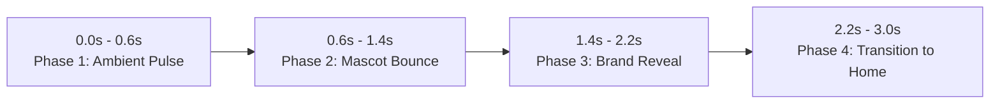

# Baby Book Animated Splash Screen Skill

Use this skill whenever you need to create, design, or animate a mobile Splash / Launch Screen that matches the visual identity of the Baby Book app flow.

---

## 🎨 Visual Identity & Matching Tokens

The splash screen MUST visually inherit from the previously established design system:

| Token | Value | Role on Splash Screen |
| :--- | :--- | :--- |
| **Primary Canvas** | Deep Indigo Gradient (`from-indigo-600 via-indigo-700 to-purple-800`) | Background surface providing visual continuity with the "Baby Book" hero card. |
| **Accent Glow** | Amber Glow (`#FDE68A` / `#F59E0B`) | Radiating background pulse behind the mascot/book icon. |
| **Mascot Icon** | 🐣 (Baby Chick) & 📚 (Book) | Central animated character or book opening motif. |
| **Brand Typography** | Bold rounded font (`Fredoka` or `Nunito`) | App title: "Baby Nook" in crisp white with amber subline. |
| **Tagline** | "Stories for curious little minds" | Soft lavender/slate subtext fading in on stage 3. |

---

## ⏱️ Animation Choreography (The 3-Second Flow)

The splash animation must feel warm, gentle, and child-friendly:

1. **Phase 1: Ambient Background Pulse (0.0s – 0.6s)**
    - Background subtle glowing rings expand gently outwards.
    - Floating playful stars (`✨`, `⭐`, `☁️`) fade in with gentle drifting movement.

2. **Phase 2: Mascot Pop & Book Opening (0.6s – 1.4s)**
    - Center card springs up using an elastic ease (`cubic-bezier(0.34, 1.56, 0.64, 1)`).
    - The book/egg icon executes a playful wiggle and scales to full size (`scale-110` -> `scale-100`).

3. **Phase 3: Brand Typography Cascade (1.4s – 2.2s)**
    - **"Baby Nook 🐣"** slides up with a crisp fade-in.
    - Tagline *"Curated reads for 0–24 months"* fades in with an animated loading progress pill.

4. **Phase 4: Smooth Seamless Exit (2.2s – 3.0s)**
    - Splash card smoothly fades and scales out (`opacity: 0`, `scale: 1.08`).
    - Revealing **Screen 01 (Home Screen)** with the prominent "Baby Book" button ready for interaction.

---

## 🛠️ Code Implementation Guidelines

When generating the splash screen artifact:
1. **Self-Contained Tailwind CSS & Keyframe Styles:** Include CSS `@keyframes` for `elasticPop`, `softFloat`, and `pulseRing`.
2. **Interactive Controls:** Provide a **"🔁 Replay Splash"** button and an auto-advance timer to test the real app launch experience.
3. **Dual State:**
    - **Storyboard State:** Shows the 3 key animation states side-by-side (Entrance, Full Reveal, and Exit).
    - **Interactive Live Phone:** Allows experiencing the real 2.6-second animated launch directly inside the phone bezel.